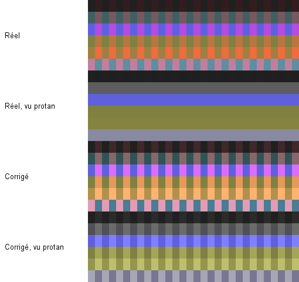
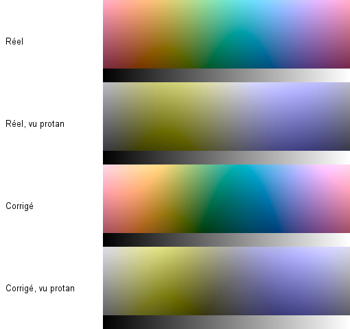
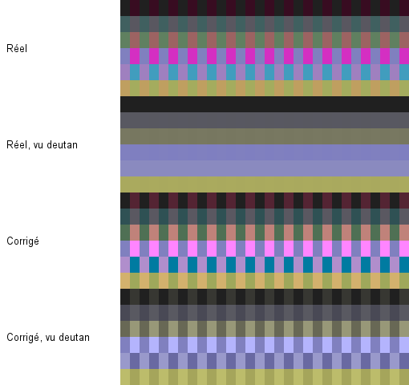
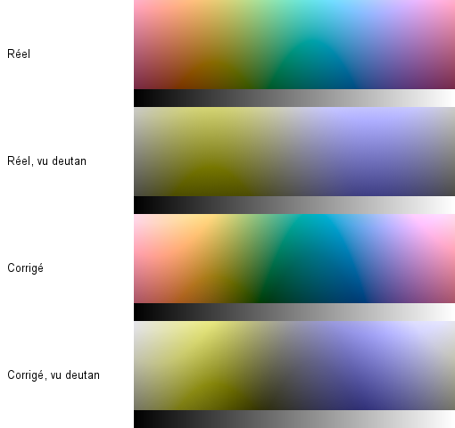
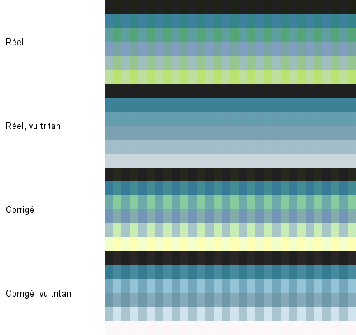
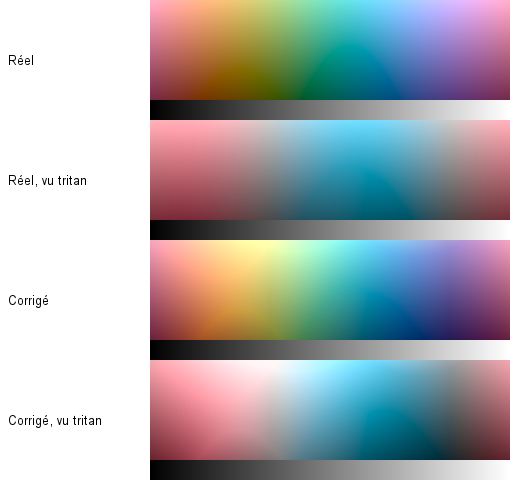

# Mesures des algorithmes

Fichier généré par `npm run report` (`core/src/jvmTest/.../ReportTest.kt`) : ne pas le modifier à la main.
Toutes les images sont synthétiques. ΔE = CIEDE2000.

## Corrections à intensité 100 %

Paires de couleurs que le profil confond (ΔE < 5 à travers sa simulation, ΔE ≥ 8 pour une vision typique), prises sur ses lignes de confusion. « Avant → après » : ΔE moyen entre les deux couleurs d’une paire, vues à travers la simulation. « Distinctes » : part des paires à ΔE ≥ 5 après correction. « Coût » : ΔE moyen entre une couleur et sa correction (vision typique). « Peau » : ΔE moyen des tons chair, et leur plus grand décalage de teinte. « Gris » : plus grand ΔE d’un gris.

| Axe | Sévérité | Stratégie | Paires | Avant → après | Distinctes | Coût | Peau | Teinte peau | Gris |
|---|---:|---|---:|---:|---:|---:|---:|---:|---:|
| Protan | 20 % | redistribution d’erreur | 0 | — → — | — | 4.0 | 2.8 | 7° | 0.00 |
| Protan | 20 % | remappage CIELAB (défaut) | 0 | — → — | — | 5.4 | 2.7 | 7° | 0.00 |
| Protan | 40 % | redistribution d’erreur | 91 | 4.5 → 5.6 | 76 % | 6.6 | 4.7 | 11° | 0.00 |
| Protan | 40 % | remappage CIELAB (défaut) | 91 | 4.5 → 8.2 | 97 % | 9.2 | 4.6 | 15° | 0.00 |
| Protan | 60 % | redistribution d’erreur | 279 | 3.4 → 6.3 | 82 % | 8.6 | 6.3 | 14° | 0.00 |
| Protan | 60 % | remappage CIELAB (défaut) | 279 | 3.4 → 9.2 | 96 % | 12.0 | 6.1 | 22° | 0.00 |
| Protan | 80 % | redistribution d’erreur | 615 | 2.7 → 9.9 | 94 % | 10.2 | 7.6 | 15° | 0.00 |
| Protan | 80 % | remappage CIELAB (défaut) | 615 | 2.7 → 13.5 | 96 % | 14.2 | 7.4 | 29° | 0.00 |
| Protan | 100 % | redistribution d’erreur | 818 | 0.0 → 13.5 | 98 % | 11.5 | 9.6 | 14° | 0.00 |
| Protan | 100 % | remappage CIELAB (défaut) | 818 | 0.0 → 16.0 | 98 % | 13.1 | 10.0 | 43° | 0.00 |
| Deutan | 20 % | redistribution d’erreur | 0 | — → — | — | 3.8 | 2.6 | 12° | 0.00 |
| Deutan | 20 % | remappage CIELAB (défaut) | 0 | — → — | — | 5.9 | 3.0 | 8° | 0.00 |
| Deutan | 40 % | redistribution d’erreur | 99 | 4.5 → 5.0 | 51 % | 5.8 | 4.2 | 20° | 0.00 |
| Deutan | 40 % | remappage CIELAB (défaut) | 99 | 4.5 → 7.1 | 92 % | 9.8 | 5.1 | 17° | 0.00 |
| Deutan | 60 % | redistribution d’erreur | 317 | 3.4 → 5.2 | 44 % | 7.2 | 5.3 | 26° | 0.00 |
| Deutan | 60 % | remappage CIELAB (défaut) | 317 | 3.4 → 8.9 | 89 % | 12.6 | 6.7 | 25° | 0.00 |
| Deutan | 80 % | redistribution d’erreur | 691 | 2.6 → 7.5 | 65 % | 8.1 | 6.2 | 30° | 0.00 |
| Deutan | 80 % | remappage CIELAB (défaut) | 691 | 2.6 → 13.9 | 94 % | 14.7 | 7.9 | 32° | 0.00 |
| Deutan | 100 % | redistribution d’erreur | 863 | 0.0 → 11.1 | 79 % | 7.6 | 8.3 | 39° | 0.00 |
| Deutan | 100 % | remappage CIELAB (défaut) | 863 | 0.0 → 18.2 | 97 % | 14.6 | 10.9 | 49° | 0.00 |
| Tritan | 20 % | redistribution d’erreur | 0 | — → — | — | 2.9 | 1.0 | 2° | 0.00 |
| Tritan | 20 % | remappage CIELAB (défaut) | 0 | — → — | — | 4.0 | 1.6 | 2° | 0.00 |
| Tritan | 40 % | redistribution d’erreur | 8 | 4.8 → 4.4 | 0 % | 5.6 | 2.1 | 5° | 0.00 |
| Tritan | 40 % | remappage CIELAB (défaut) | 8 | 4.8 → 5.6 | 88 % | 7.1 | 3.0 | 4° | 0.00 |
| Tritan | 60 % | redistribution d’erreur | 128 | 4.2 → 4.6 | 35 % | 8.3 | 3.2 | 8° | 0.00 |
| Tritan | 60 % | remappage CIELAB (défaut) | 128 | 4.2 → 5.9 | 81 % | 9.8 | 4.4 | 6° | 0.00 |
| Tritan | 80 % | redistribution d’erreur | 310 | 2.9 → 5.7 | 60 % | 10.9 | 4.4 | 11° | 0.00 |
| Tritan | 80 % | remappage CIELAB (défaut) | 310 | 2.9 → 7.4 | 89 % | 12.3 | 5.7 | 11° | 0.00 |
| Tritan | 100 % | redistribution d’erreur | 361 | 0.0 → 7.3 | 73 % | 13.5 | 5.6 | 15° | 0.00 |
| Tritan | 100 % | remappage CIELAB (défaut) | 361 | 0.0 → 9.1 | 89 % | 14.8 | 6.9 | 16° | 0.00 |

## Comparaison à coût égal

Chaque stratégie est réglée pour modifier l’image d’un ΔE moyen de 8, puis on compare ce qu’elle sépare. Les variantes du remappage (gains chroma / clarté) montrent d’où vient le choix par défaut.

| Axe | Sévérité | Stratégie | Distinctes | Avant → après | Teinte peau |
|---|---:|---|---:|---:|---:|
| Protan | 60 % | redistribution d’erreur | 76 % | 3.4 → 6.0 | 13° |
| Protan | 60 % | remappage CIELAB (défaut) | 90 % | 3.4 → 6.8 | 12° |
| Protan | 60 % | CIELAB 1 / 0 | 84 % | 3.4 → 7.4 | 18° |
| Protan | 60 % | CIELAB 0,6 / 0,6 | 90 % | 3.4 → 6.9 | 19° |
| Protan | 60 % | CIELAB 0 / 1 | 88 % | 3.4 → 6.7 | 8° |
| Protan | 100 % | redistribution d’erreur | 80 % | 0.0 → 9.7 | 10° |
| Protan | 100 % | remappage CIELAB (défaut) | 87 % | 0.0 → 9.9 | 20° |
| Protan | 100 % | CIELAB 1 / 0 | 76 % | 0.0 → 10.6 | 24° |
| Protan | 100 % | CIELAB 0,6 / 0,6 | 85 % | 0.0 → 9.9 | 27° |
| Protan | 100 % | CIELAB 0 / 1 | 88 % | 0.0 → 10.0 | 13° |
| Deutan | 60 % | redistribution d’erreur | 45 % | 3.4 → 5.5 | 29° |
| Deutan | 60 % | remappage CIELAB (défaut) | 77 % | 3.4 → 6.2 | 13° |
| Deutan | 60 % | CIELAB 1 / 0 | 74 % | 3.4 → 7.0 | 19° |
| Deutan | 60 % | CIELAB 0,6 / 0,6 | 77 % | 3.4 → 6.2 | 19° |
| Deutan | 60 % | CIELAB 0 / 1 | 77 % | 3.4 → 6.2 | 8° |
| Deutan | 100 % | redistribution d’erreur | 80 % | 0.0 → 11.8 | 41° |
| Deutan | 100 % | remappage CIELAB (défaut) | 86 % | 0.0 → 10.3 | 19° |
| Deutan | 100 % | CIELAB 1 / 0 | 77 % | 0.0 → 12.5 | 23° |
| Deutan | 100 % | CIELAB 0,6 / 0,6 | 84 % | 0.0 → 10.5 | 26° |
| Deutan | 100 % | CIELAB 0 / 1 | 87 % | 0.0 → 10.5 | 12° |
| Tritan | 60 % | redistribution d’erreur | 33 % | 4.2 → 4.6 | 8° |
| Tritan | 60 % | remappage CIELAB (défaut) | 65 % | 4.2 → 5.4 | 4° |
| Tritan | 60 % | CIELAB 1 / 0 | 28 % | 4.2 → 4.6 | 16° |
| Tritan | 60 % | CIELAB 0,6 / 0,6 | 45 % | 4.2 → 5.1 | 10° |
| Tritan | 60 % | CIELAB 0 / 1 | 74 % | 4.2 → 5.5 | 5° |
| Tritan | 100 % | redistribution d’erreur | 33 % | 0.0 → 4.6 | 8° |
| Tritan | 100 % | remappage CIELAB (défaut) | 38 % | 0.0 → 4.9 | 4° |
| Tritan | 100 % | CIELAB 1 / 0 | 38 % | 0.0 → 5.2 | 16° |
| Tritan | 100 % | CIELAB 0,6 / 0,6 | 40 % | 0.0 → 5.1 | 9° |
| Tritan | 100 % | CIELAB 0 / 1 | 35 % | 0.0 → 4.8 | 5° |

## Taille de la LUT

ΔE entre la fonction exacte et la LUT après passage en texture RGBA8 et interpolation trilinéaire (ce que fait le GPU), sur 5000 couleurs tirées au hasard : moyenne / 99e centile / maximum.

| Mode | 17³ | 25³ | 33³ | 49³ | 65³ |
|---|---:|---:|---:|---:|---:|
| simulation deutan 100 % | 0.08 / 0.31 / 0.51 | 0.08 / 0.28 / 0.47 | 0.08 / 0.28 / 0.40 | 0.07 / 0.26 / 0.56 | 0.08 / 0.30 / 0.46 |
| simulation tritan 100 % | 0.17 / 1.14 / 1.82 | 0.13 / 0.76 / 1.35 | 0.12 / 0.54 / 1.17 | 0.11 / 0.40 / 0.89 | 0.10 / 0.37 / 0.76 |
| correction deutan 100 % + contraste | 0.22 / 1.66 / 3.49 | 0.13 / 0.96 / 2.67 | 0.09 / 0.66 / 1.56 | 0.07 / 0.39 / 1.01 | 0.06 / 0.30 / 0.92 |
| correction tritan 100 % | 0.23 / 1.93 / 3.46 | 0.14 / 1.28 / 3.57 | 0.10 / 0.78 / 1.59 | 0.08 / 0.47 / 1.21 | 0.07 / 0.33 / 0.96 |
| isoler le rouge | 0.49 / 8.88 / 13.04 | 0.29 / 5.95 / 11.32 | 0.20 / 3.98 / 7.98 | 0.12 / 2.21 / 5.28 | 0.09 / 1.27 / 3.80 |

## Temps de cuisson

JVM du PC de développement, à titre indicatif (correction + contraste, médiane de 5) :

- 17³ : 1.1 ms
- 33³ : 7.5 ms
- 49³ : 26.2 ms

## Images de comparaison

De haut en bas : réel, réel vu avec le profil, corrigé (stratégie par défaut, intensité 70 %), corrigé vu avec le profil. Sévérité 100 %.

